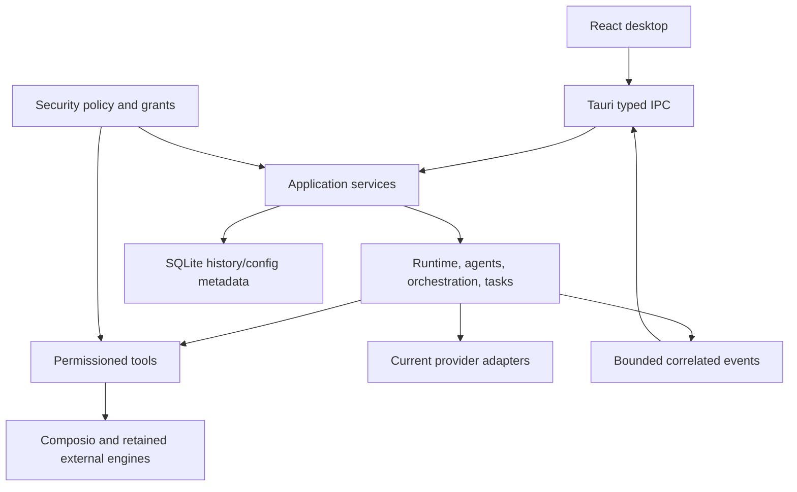

# ATOM Studio Migration Blueprint

**Status:** Initial definitive blueprint for review; implementation has not started.

## 1. Executive decision

Build ATOM Studio as a **Tauri 2 desktop modular monolith**: Rust core owns runtime, task orchestration, tools, providers, policy and persistence; React/TypeScript renders an original UI and communicates through a typed Tauri boundary. Keep OpenSwarm intact as the reference. Start with one Rust core crate and one desktop app, not a constellation of empty crates or services.

Migrate existing OpenSwarm capability only. Existing image/video/audio behavior remains in scope; Voicebox, AutoClip, new creative studios, engines, agents and unrelated functionality are excluded. Treat safety changes as explicit compatibility changes. Do not claim generated-code sandboxing or performance gains without evidence.

## 2. Repository facts driving the design

- `swarm.py` creates eight agents and a broad handoff graph; Agency Swarm owns lifecycle and much of context/transport behavior.
- `server.py` delegates the FastAPI app/routes to Agency Swarm; route/auth/stream contract is not established in first-party source.
- `config.py` chooses default OpenAI or slash-prefixed LiteLLM model routing.
- Existing specialist features include Composio connected-service actions, web/scholarly research, persistent Python/shell analysis, document and PPTX pipelines, image generation/editing, and video/audio tools.
- `run_utils.py`, `bin/`, `package.json`, `openswarm.config.mjs`, Docker and CI implement platform launcher/bootstrap/product configuration beyond the agent runtime.
- The analyzer reports 142 Python files, ~21,355 LOC, two Python test files, 30 units (12 ready, 17 caution, one blocked), broad coupling/import cycles.
- Current tests and workflow smoke checks do not characterize the complete product. No performance numbers or security penetration results exist.
- Local environment observed: Windows, Rust/Cargo 1.100, Node 26.13, npm 11.20, Python 3.13. This does not define customer support targets.

## 3. Architecture synopsis

Core modules are private at first: runtime, agents, orchestration, tasks, tools, providers, context, events, persistence, security, config and observability. Tauri is a thin adapter. External conversion/process engines use explicit boundaries, limits and failure reporting. No speculative distributed layer.

## 4. Desktop and UX

Use a left workspace/session navigation, a central task/conversation surface and a collapsible agent/task/tool inspector. Deliverable browsing (documents, slides, images, existing video/audio outputs), integrations/permissions and settings are first-class destinations. Show task lifecycle, agent activity, tool side effects, stream, cancellation, artifacts and failures; do not create a generic blank chat clone. Dark-first semantic tokens, keyboard access, contrast, reduced motion and responsive narrow-window behavior are required. Provider credentials remain in OS secure storage and are never returned to UI.

## 5. Safety posture

- Capability grants and approvals are enforced by Rust, not prompts/UI alone.
- Workspace file access uses scoped roots with traversal/symlink tests.
- Network operations enforce TLS, timeouts, size bounds, redirect policy and SSRF controls.
- Shell/Python remain disabled until actual OS-level isolation has been designed and verified.
- Bounded queues, concurrency, context, process runtime and tool output; cancellation/deadlines propagate.
- Structured traces/events redact credentials and sensitive payloads.
- Update/package signing and supported target matrix are release blockers to decide.

## 6. Migration approach

Characterize OpenSwarm interactions and artifacts before porting; capture actual API routes from the pinned runtime. Build the desktop foundation and design system, then core lifecycle/events/provider streaming, then agent/orchestration and tools. Migrate existing research/assistant, analytics, docs/slides and current media workflows in dependency-aware waves. Preserve mature renderers/codecs where reimplementation would reduce compatibility, with explicit process/resource boundaries. Add history/settings, compatibility paths and signed packaging after contracts are clear. See `MIGRATION_ROADMAP.md` and `FEATURE_MIGRATION_MATRIX.md`.

## 7. Workspace and dependencies

Proposed `rust/` workspace: `apps/desktop/src-tauri`, `apps/desktop/ui`, `crates/atom-core`, tests/docs/scripts. Initially use Tauri 2, Tokio, Reqwest/Rustls, Serde, thiserror, tracing, rusqlite, UUID, React/TS/Vite/Tailwind. These are provisional decisions; validate with a first-target build and minimize provider-specific SDKs. See `RUST_WORKSPACE_STRUCTURE.md` and `DEPENDENCY_DECISIONS.md`.

## 8. Verification and release

Characterization, unit, integration, provider/IPC contract, UI accessibility, security, concurrency, end-to-end, artifact, and performance tests are defined in `TESTING_STRATEGY.md`. Baseline plan measures startup, memory, scheduling, first-token and completion latency, tool dispatch, UI responsiveness and artifact workloads without conflating external provider latency with Rust overhead. No targets are invented before measurements.

## 9. Required review decisions

Before implementation, confirm:
1. Supported desktop OS/architectures and minimum hardware.
2. MVP capabilities and whether HTTP/API and CLI compatibility are required in the desktop product.
3. Whether Composio behavior must be preserved via an adapter, and allowed connected-service action scopes.
4. Whether data analysis must retain Python via an isolated worker or can initially narrow to specified Rust-native operations.
5. Whether shell/Python can be disabled until isolation is verified.
6. Installer/update/signing and local state migration expectations.

## Linked deliverables

- `ATOM_STUDIO_SCOPE.md`
- `OPENSWARM_FEATURE_INVENTORY.md`
- `FEATURE_MIGRATION_MATRIX.md`
- `RUST_ARCHITECTURE.md`
- `DESKTOP_ARCHITECTURE.md`
- `UI_UX_SPECIFICATION.md`
- `RUST_WORKSPACE_STRUCTURE.md`
- `DEPENDENCY_DECISIONS.md`
- `SECURITY_THREAT_MODEL.md`
- `PERFORMANCE_BASELINE_PLAN.md`
- `TESTING_STRATEGY.md`
- `MIGRATION_ROADMAP.md`
- `MVP_ACCEPTANCE_CRITERIA.md`
- `REVERSE_ENGINEERING_REPORT.md`
