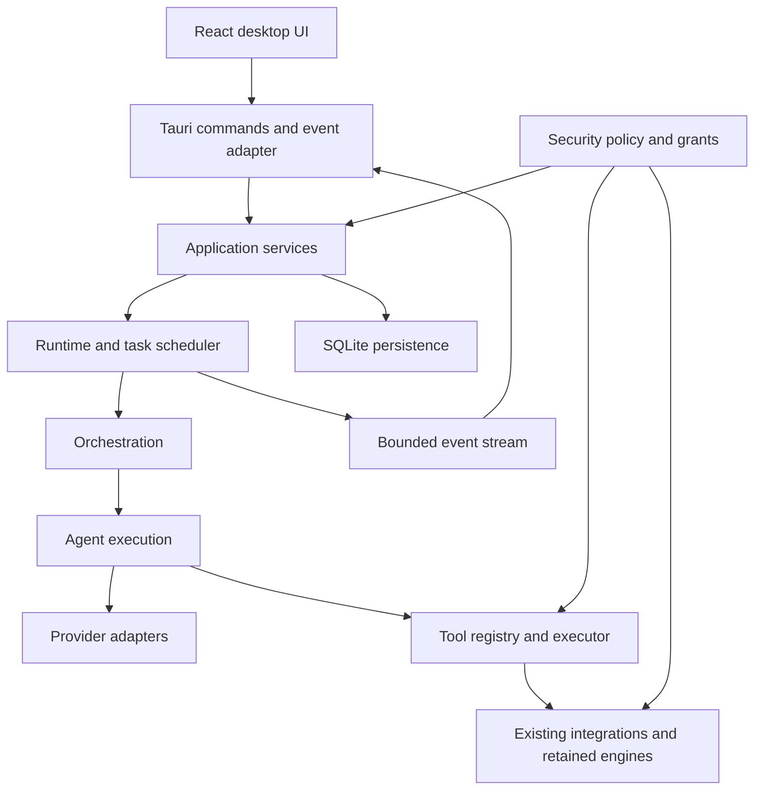
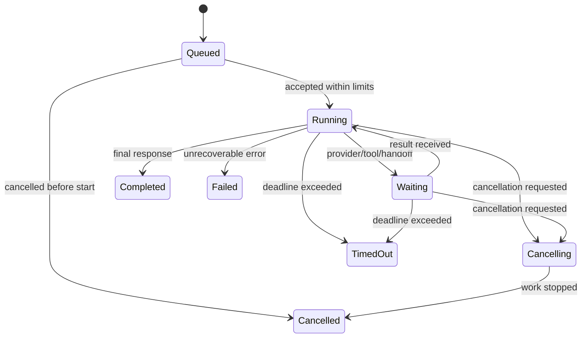

# ATOM Studio Rust Architecture

## Goals and constraints

A desktop-first modular monolith that owns orchestration, tools, providers, state and policy. The React/Tauri shell is a client of the engine, not an owner of domain logic. Keep original OpenSwarm as the reference during migration. Avoid empty crates and distributed services.

## Proposed component model

## Responsibilities

- **Application services:** UI-facing use cases: create/resume session, submit/cancel task, manage workspace/provider settings, query history/artifacts. Validate DTOs and apply authorization.
- **Runtime:** Own task/agent lifecycle, cancellation tokens, deadlines, concurrency/resource budgets and graceful shutdown. No unbounded detached tasks.
- **Orchestration:** Initially implement only behavior evidenced in OpenSwarm: orchestrator-to-specialist messaging, handoffs and specialist execution. Parallelism is bounded. Strategies are concrete policy/config, not a speculative strategy plugin framework.
- **Agent:** Stable agent identity, prompt/instruction assembly, provider/model settings, scoped tool capabilities, context and lifecycle transitions.
- **Provider:** Async request/stream interface, explicit capability metadata and typed provider errors. Implement adapters only for providers used by existing features and verify each against current APIs.
- **Tools/integrations:** Typed schemas, input validation, capability grant checks, risk class, timeout, cancellation, bounded output and audit event. Composio may be an external adapter only after Rust API and behavior are validated.
- **Context/memory:** Conversation/task context limits and pruning rules. Persisted session records are not an implicit unlimited model context.
- **Persistence:** SQLite migrations and transactions for sessions, messages, tasks, events, settings metadata and artifact references. Secrets are not stored as ordinary database values.
- **Events/observability:** Correlated structured events with bounded delivery, explicit treatment of critical event persistence, tracing spans with redaction.
- **Security:** Central policy services for workspace roots, provider secrets, network targets, tool capabilities and user approval. UI confirmation is not authorization by itself.

## Execution lifecycle

Every transition is validated; task and agent status are separate. Tool calls are recorded as activity with redacted input/output summaries and explicit outcome. Retries are policy-driven and limited to safe/idempotent operations unless a user confirms otherwise.

## Concurrency, resource and failure model

Use Tokio for I/O-bound providers, IPC-adjacent services, and controlled task concurrency. Bound task queues, per-session active agents, provider requests, tool output and media process resources. Propagate cancellation/deadlines end to end. Blocking filesystem/media/conversion work runs on bounded blocking workers or dedicated child processes. Shutdown stops accepting work, requests cancellation, drains critical persistence, then exits. Classify errors (configuration, authorization, provider, tool, persistence, cancellation, timeout, resource limit); do not turn failures into success-shaped responses.

## Security boundary

A tool executes only after policy checks for tool ID, arguments, workspace/file scope, network destination, risk and approval state. Shell/Python are disabled until actual OS-level isolation is implemented and validated; permission prompts alone are not sandboxing. The engine never sends secrets to the UI event stream or logs. Desktop IPC commands validate all inputs and are not a general command execution API.

## Module layout recommendation

Start as one Cargo workspace with `atom-core` library and `atom-desktop` Tauri application. Organize `atom-core` into modules (`agents`, `orchestration`, `tasks`, `tools`, `providers`, `context`, `events`, `persistence`, `security`, `config`, `observability`) with internal visibility. Extract a crate only when an actual stable boundary or independent testing/build need justifies it.
