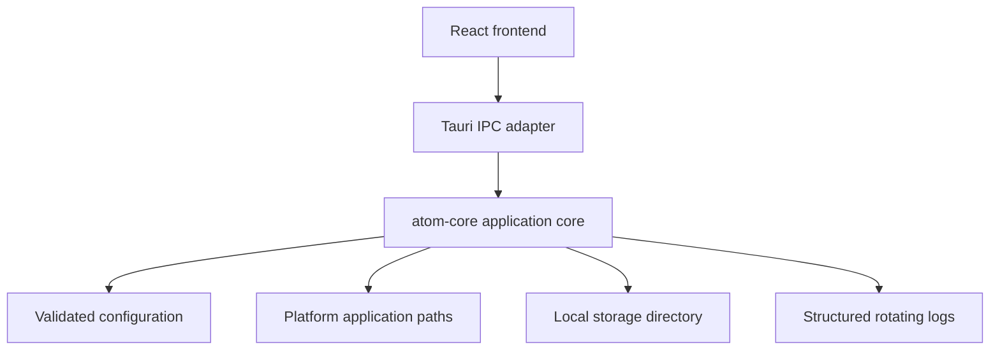

# ATOM Studio Rust Core Foundation

## Scope and current status

The M3 core is a small modular monolith in the existing Cargo workspace. It establishes application startup, local configuration, application-owned paths, diagnostics, typed boundary errors, and a local storage location. It does not implement providers, agents, orchestration, tools, workflow execution, databases, or OpenSwarm feature migration.



`atom-core` does not depend on Tauri. The desktop crate owns Tauri process startup, retains the logging worker for the application lifetime, manages the initialized core as Tauri state, and keeps command handlers thin. The existing `ipc_smoke_test` command and response contract are preserved.

## Modules and ownership

| Module | Responsibility |
|---|---|
| `config` | Defaults, TOML parsing, strict unknown-key rejection, and the `ATOM_LOG_LEVEL` override. |
| `error` | Typed internal core errors and sanitized, serializable IPC error categories. |
| `logging` | Structured tracing output to a rotating file writer; retains its worker guard for the process lifetime. |
| `paths` | Platform-aware config, data, logs, cache, and temporary paths; creates directories without deleting existing content. |
| `storage` | Creates and exposes the application-owned `data/storage` root; no database is selected or initialized. |
| `ApplicationCore` | Initializes paths, config, and local storage and exposes read-only accessors to application adapters. |
| Tauri `main.rs` | Process composition root, logging lifecycle, managed core state, and IPC command adapter. |

## Initialization flow

1. `ApplicationCore::initialize` resolves operating-system application paths using `directories::ProjectDirs`.
2. It creates config, data, logs, cache, and temporary directories with `create_dir_all`; failures remain typed and identify the failing category internally.
3. It reads `config.toml`. A missing file means defaults; malformed files and unsupported keys fail initialization rather than being silently ignored.
4. `ATOM_LOG_LEVEL`, when set, overrides the file/default level. Accepted values are `trace`, `debug`, `info`, `warn`, and `error`.
5. It initializes the `data/storage` directory. This is only a local storage boundary, not a database or an implicit persistence format.
6. Tauri initializes tracing in the app-owned logs directory, logs startup, manages the core as state, and runs the desktop event loop.
7. Shutdown and application errors are logged without logging prompts, credentials, configuration contents, or user files.

`ApplicationCore::initialize_with_paths` is the deterministic embedding/test seam. It accepts an explicit `AppPaths` and log-level override so tests do not access real user application data.

## Configuration and secrets

The configuration file is `config/config.toml` under the platform-resolved application config directory. Its current supported setting is:

```toml
log_level = "info"
```

No credentials or provider settings exist in this milestone. Do not put secrets in this file or expose it through IPC. Missing configuration is not written back automatically. Invalid values are rejected with an error that does not echo the provided value.

## Errors and IPC boundary

Core operations use `CoreError`, `ConfigError`, `StorageError`, and `LoggingError` rather than panics for ordinary failures. Internal errors preserve their source for diagnosis. `IpcError` serializes stable `code` and `message` fields and intentionally omits paths and underlying OS/parser details. The current smoke command is infallible and continues returning the existing string; the conversion type is tested as the boundary contract for future fallible commands.

Startup errors occur before IPC is available and are returned from the bootstrap path; the desktop entry point reports a concise failure and exits non-zero instead of using `expect`/panic for normal startup failure.

## Logging

The desktop process writes `atom-studio` daily rolling log files under the app-owned logs directory. The appender retains at most seven log files. The configured log level controls the filter. The non-blocking worker guard is kept alive until the Tauri run loop ends. Logs contain lifecycle and diagnostic events only; do not add raw prompts, file contents, credentials, or provider payloads.

## Application directories and storage

`AppPaths` obtains OS-specific locations through the `directories` crate, never a hard-coded home directory. Logs are under the application data root; temporary files are under the application cache root. Directory creation is non-destructive and errors are typed. Tests use unique temporary roots and verify that existing files remain intact when initialization fails.

`LocalStorage` currently owns only the path `data/storage`. Add persistence formats only when a concrete M3+ use case, data-retention policy, migration plan, and tests justify the choice. No database, vector store, conversation history, cloud sync, or agent memory is present.

## Dependency decisions

- `directories`: platform-aware OS application directories without coupling core to Tauri.
- `serde` and `toml`: typed, strict, human-editable application configuration and IPC error serialization.
- `thiserror`: concise typed error sources and context categories.
- `tracing`, `tracing-subscriber`, and `tracing-appender`: structured diagnostics, level filtering, non-blocking daily rotation, and bounded file retention suitable for a desktop process.
- `serde_json` (development dependency): verifies the actual serialized IPC error shape.

No async runtime, database, plugin framework, or provider dependency is introduced; current initialization is synchronous local filesystem work.

## Testing and verification

From `rust/`:

```sh
cargo fmt --all -- --check
cargo check --workspace
cargo test --workspace
cargo clippy --workspace --all-targets -- -D warnings
cargo build --workspace
```

From `rust/apps/desktop/`:

```sh
npm run build
npm run verify:ipc
```

Core tests use temporary paths to exercise defaults, file/environment precedence, invalid settings, error redaction/serialization, safe directory creation, storage initialization, and the application-core/IPC behavior. `verify:ipc` separately launches the Windows desktop shell and validates the live frontend-to-Rust path.

## Extension rules

Future application services should enter through `ApplicationCore` without importing Tauri types into `atom-core`. Add a module only when it owns behavior required by an accepted issue. Keep IPC DTOs stable and sanitized; place serialization and OS-specific interaction in adapters. Select persistent stores, async execution, provider APIs, or retained Python engines only in the milestone that implements a concrete feature and its security, resource, and compatibility contracts.
